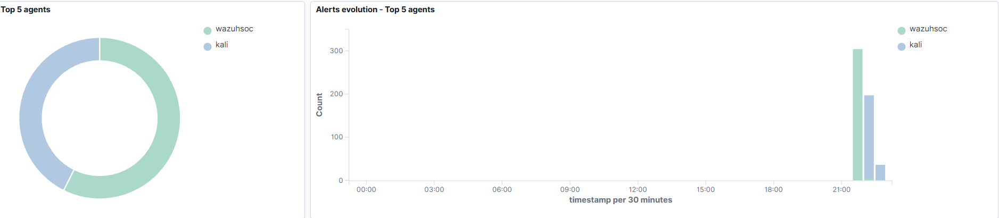
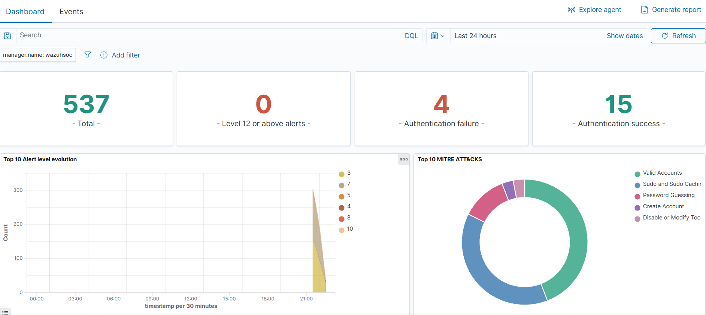
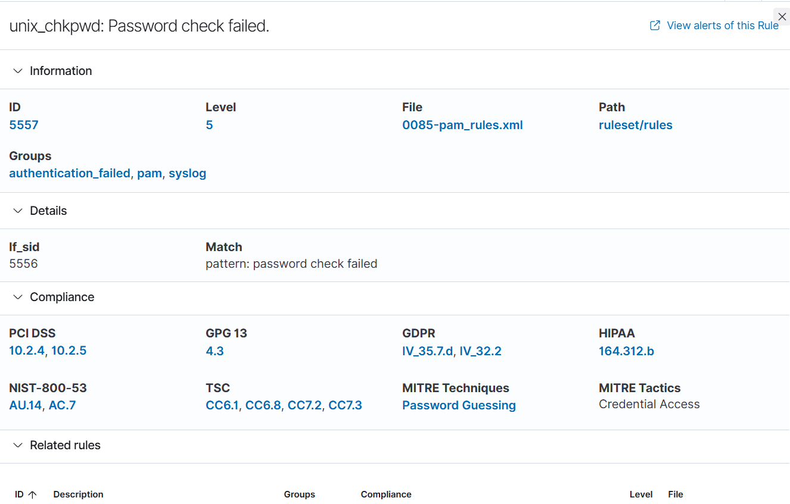
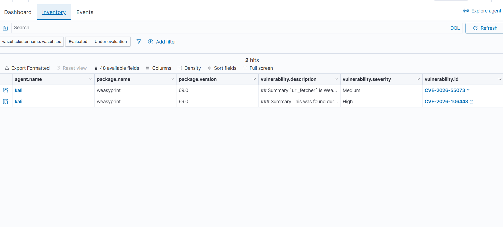

## Laboratorio SOC con Wazuh: despliegue, monitoreo y detección.

Laboratorio personal de Blue Team / Analista SOC: despliegue de un SIEM/XDR (Wazuh
4.14.9) sobre Ubuntu 24.04 en VMware Workstation, conexión de un endpoint Kali Linux
como agente, generación de eventos de autenticación fallida e investigación en el
dashboard con mapeo a MITRE ATT&CK.

**Entorno de laboratorio aislado, creado con fines de aprendizaje. No es un despliegue de producción**.

## Objetivo

Practicar el ciclo básico de un analista SOC:

Desplegar la herramienta → recolectar telemetría → generar un evento → detectarlo → investigarlo.

## Arquitectura
```

┌──────────────────────────────┐       ┌──────────────────────────┐
│  VM Ubuntu 24.04 LTS         │       |   VM Kali Linux          │
│Wazuh 4.14.9 (todo en uno)    │◄──────|  Agente Wazuh 4.14.9     │
│Indexer + Manager + Dashboard │ 1514  │ (endpoint monitorizado)  │
└──────────────────────────────┘       └──────────────────────────┘
                   Red NAT de VMware (misma subred)

```

| Componente | Detalle |
|---|---|
| Hipervisor | VMware Workstation |
| Servidor | Ubuntu 24.04 LTS, disco de 50 GB con LVM, RAM ampliada para el indexer |
| Wazuh | 4.14.9, instalación asistida todo en uno |
| Endpoint | Kali Linux con agente Wazuh 4.14.9 |
| Red | NAT de VMware |


## Pasos realizados
````

### 1. Instalación de Ubuntu Server
- Disco completo con LVM, ampliando '/' a todo el espacio disponible.
- Cifrado LUKS desactivado (innecesario en el laboratorio).
- OpenSSH server habilitado para administrar la VM de forma remota.

### 2. Instalación de Wazuh
Con el sistema actualizado, se usó el instalador asistido oficial:
```
sudo apt update && sudo apt upgrade -y
curl -sO https://packages.wazuh.com/4.14/wazuh-install.sh
sudo bash ./wazuh-install.sh -a
```
El instalador configura el indexer, el manager y el dashboard, genera los certificados y muestra el usuario 'admin' con una contraseña inicial. Se accede por 'https://<IP_SERVIDOR>'.

### 3. Cambio de la contraseña inicial
```
curl -so wazuh-passwords-tool.sh https://packages.wazuh.com/4.14/wazuh-passwords-tool.sh
sudo bash wazuh-passwords-tool.sh -u admin -p '<nueva_contraseña>'
```

La herramienta exige entre 8 y 64 caracteres, con mayúscula, minúscula, número y un símbolo del conjunto '. * + ? -'.

### 4. Instalación del agente en Kali
```
wget https://packages.wazuh.com/4.x/apt/pool/main/w/wazuh-agent/wazuh-agent_4.14.9-1_amd64.deb
sudo WAZUH_MANAGER='<IP_SERVIDOR>' WAZUH_AGENT_NAME='kali' dpkg -i ./wazuh-agent_4.14.9-1_amd64.deb

sudo systemctl daemon-reload
sudo systemctl enable wazuh-agent
sudo systemctl start wazuh-agent
sudo systemctl status wazuh-agent --no-pager
```
Resultado: el agente aparece como **Active** en **Endpoints Summary** (versión 4.14.9, grupo 'default').



### 5. Generación de eventos
   
En el endpoint se introdujo una contraseña incorrecta en `sudo` varias veces:
```
sudo -k
sudo ls # contraseña incorrecta x3
````

## Detección e investigación

En Threat Hunting, últimas 24 horas:
- 535 eventos totales y 0 alertas de nivel 12 o superior.
- 3 fallos de autenticación y 15 autenticaciones exitosas.
- Técnicas MITRE ATT&CK observadas: Valid Accounts, Sudo and Sudo Caching, Password Guessing, Create Account y Disable or Modify Tools.
  


### Mapeo a MITREE ATT&CK

El panel de MITREE ATT&CK de Wazuh agrupa las alertas por tácticas y técnicas, y las separas por agente ('kali' y el servidor 'wazuhsoc').


## Regla que detectó los intentos fallidos

| Campo | Valor |
|--- | --- |
| ID | 5557 |
| Descripción | unix_chkpwd: Password check failed |
| Nivel | 5 |
| Grupos | authentication_failed, pam , syslog |
| Regla padre |  5556 |
| Patrón | password check failed |
| Técnica MITRE | **Password Guessing** |
| Táctica MITRE | **Credential Access** |
| Cumplimiento | PCI DSS 10.2.4 / 10.2.5, NIST 800-53 AU.14 / AC.7, GDPR, HIPAA, TSC |



## Conclusión: 

Una serie de fallos de contraseña en un endpoint se detecta de forma automática, se clasifica como intento de adivinación de credenciales y queda trazada hasta
el log original (full_log), lo que permite reconstruir qué ocurrió, cuándo y en qué host.

## Detección de vulnerabilidades

Se revisó el módulo Vulnerability Detection sobre el inventario de paquetes del agente, que muestra métricas de severidad y paquetes afectados para priorizar la remediación
según criticidad y exposición.



## Problemas encontrados y cómo se resolvieron

| Problema | Diagnótico | Solución |
|--------|-----|-----------|
| El instalador de Ubuntu falló al instalar el kernel | Error durante la descarga de paquetes | Reinicio del instalador y reintento |
| El script de Wazuh pesaba 111 bytes | cat mostró un Access Denied en XML: la ruta 4.x ya no servía el script | Descarga desde la ruta de la versión vigente (4.14)| 
| Contraseña de admin rechazada | La herramienta exige un símbolo del conjunto . * + ? - | Ajuste de la contraseña a esa política | 
| wget fallaba en Kali (Temporary failure in name resolution) | ping a IP funcionaba, ping a nombres no: fallo de DNS | Configuración manual de un servidor DNS en /etc/resolv.conf |

## Habilidades demostradas

- Despliegue y administración básica de un SIEM/XDR.
- Instalación y verificación de agentes en endpoints Linux.
- Lectura y análisis de alertas, reglas, niveles y full_log .
- Mapeo de eventos a **MITRE ATT&CK** y a marcos de cumplimiento.
- Diagnóstico de red (ping, DNS, conectividad entre VMs) y resolución de errores.
- Documentación técnica con evidencias.

## Referencias
- [Documentación oficial de Wazuh](https://Documentation.wazuh.com/current/)
- [MITRE ATT&CK](https://attack.mitre.org/)

----

**Autor:** Ruth Pérez  
**Linkendin:** [linkedin.com/in/ruthperezreyes](https://www.linkedin.com/in/ruthperezreyes)

**Enfoque SOC / Incident Response**
  
